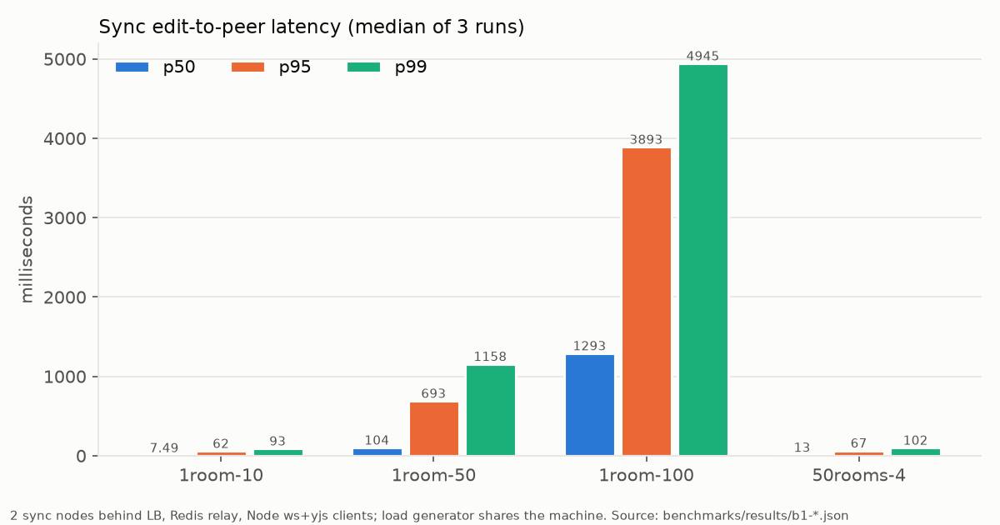
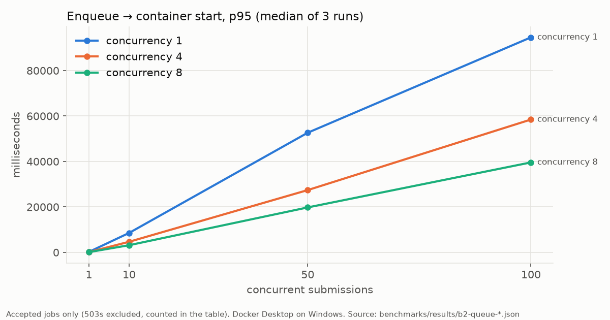
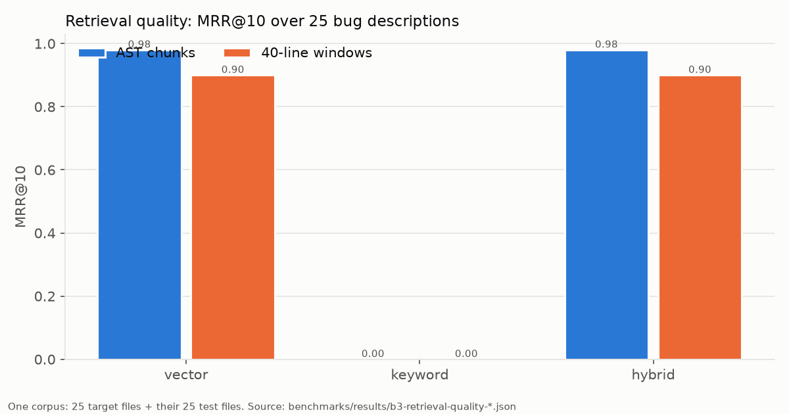

## Results

Generated by `python benchmarks/report.py` from `benchmarks/results/*.json`; every number below is read from those files. Each benchmark: 1 warm-up + 3 measured runs; the median run (by p50) is shown with the spread across runs.

### Real-browser sync tests (A2)
| Run | Tests | Passed | Failed | Flaky | Retries | Duration (s) |
|---|---|---|---|---|---|---|
| 1 | 6 | 6 | 0 | 0 | 0 | 119.2 |
| 2 | 6 | 6 | 0 | 0 | 0 | 118.7 |
| 3 | 6 | 6 | 0 | 0 | 0 | 125.2 |

Conditions: tests/playwright browser-*.spec.ts: Chromium contexts on /e2e/editor (Monaco + y-monaco), real sync nodes; 2 sync nodes + Node LB (node-kill spec: its own private pair + LB), API for cross-node Accept, NEXT_PUBLIC_E2E=1 production build. Source: `benchmarks/results/a2-browser-suite.json`.

Browser edit-to-peer latency (`browser-latency.spec.ts`, 30 samples per suite run):

| Suite run | n | p50 ms | p95 ms | p99 ms | min | max |
|---|---|---|---|---|---|---|
| 1 | 30 | 49.6 | 96.4 | 100.9 | 20.7 | 100.9 |
| 2 | 30 | 42.6 | 122.3 | 125.8 | 21.1 | 125.8 |
| 3 | 30 | 38.6 | 99.5 | 104.5 | 15.9 | 104.5 |

Conditions: stamp in A's page just before keyboard.insertText -> marker first in B's Monaco DOM (MutationObserver); performance.timeOrigin+now; includes one Playwright round trip (over-estimates); browser A -> node 1 :4041 direct, browser B -> node 2 :4042 direct; 2 Chromium 156.0.8078.4 contexts, headless, one browser process.

### B1 · Sync latency
| Scenario | Clients | p50 ms | p95 ms | p99 ms | p95 spread (3 runs) | same-node p50/p95 | cross-node p50/p95 | Missing deliveries | Conditions |
|---|---|---|---|---|---|---|---|---|---|
| 1room-10clients | 10 | 7.5 | 61.6 | 92.7 | 31.7–61.7 | 5.3/42.5 | 8.8/75.0 | 0 of 1800 | 1 room(s) × 10, 1 edit / 1000 ms (random phase), 2 nodes behind LB, load generator on same machine |
| 1room-50clients | 50 | 104.2 | 692.9 | 1158.4 | 283.7–959.7 | 87.0/652.9 | 119.3/724.0 | 0 of 49000 | 1 room(s) × 50, 1 edit / 1000 ms (random phase), 2 nodes behind LB, load generator on same machine |
| 1room-100clients | 100 | 1292.6 | 3892.9 | 4945.2 | 3251.4–4194.9 | 1242.4/3874.5 | 1341.5/3902.3 | 0 of 198000 | 1 room(s) × 100, 1 edit / 1000 ms (random phase), 2 nodes behind LB, load generator on same machine |
| 50rooms-4clients | 200 | 13.0 | 66.7 | 102.5 | 57.6–94.9 | 11.6/52.4 | 25.0/84.2 | 0 of 12000 | 50 room(s) × 4, 1 edit / 1000 ms (random phase), 2 nodes behind LB, load generator on same machine |

Environment: 2026-11-24T07:45:07.103Z · no commit (uncommitted tree, source digest e49c108c47ea9611) · Windows_NT 10.0.26200 (win32 x64) · Intel(R) Core(TM) Ultra 5 125H x18 · 15.4 GiB · Docker client 28.1.1 / server 28.1.1 (linux/amd64). k6 not used: k6's goja runtime cannot run the yjs/y-protocols libraries.

### B2 · Queue delay and sandbox startup
| WORKER_CONCURRENCY | Submitted | Accepted (timed) | 429 | 503 | enqueue→container p50 ms | p95 ms | p99 ms | p95 spread | queue-wait p95 ms | BullMQ final states |
|---|---|---|---|---|---|---|---|---|---|---|
| 1 | 1 | 1 | 0 | 0 | 203 | 203 | 203 | 149–214 | 0 | {"active": 1} |
| 1 | 10 | 10 | 0 | 0 | 3682 | 8545 | 8545 | 8052–8715 | 8387 | {"completed": 9, "active": 1} |
| 1 | 50 | 50 | 0 | 0 | 25011 | 52641 | 55121 | 46375–52641 | 52443 | {"completed": 50} |
| 1 | 100 | 100 | 0 | 0 | 47441 | 94614 | 100170 | 91662–101461 | 94440 | {"completed": 100} |
| 4 | 1 | 1 | 0 | 0 | 124 | 124 | 124 | 88–179 | 3 | {"active": 1} |
| 4 | 10 | 10 | 0 | 0 | 2101 | 4655 | 4655 | 4026–5073 | 4361 | {"completed": 9, "active": 1} |
| 4 | 50 | 50 | 0 | 0 | 14113 | 27401 | 28512 | 24521–28650 | 27153 | {"completed": 50} |
| 4 | 100 | 100 | 0 | 0 | 28899 | 58453 | 60633 | 53776–70152 | 58183 | {"completed": 100} |
| 8 | 1 | 1 | 0 | 0 | 99 | 99 | 99 | 89–189 | 2 | {"active": 1} |
| 8 | 10 | 10 | 0 | 0 | 598 | 3148 | 3148 | 2733–3148 | 2715 | {"completed": 8, "active": 2} |
| 8 | 50 | 50 | 0 | 0 | 10004 | 19775 | 21075 | 17919–22659 | 19348 | {"completed": 50} |
| 8 | 100 | 100 | 0 | 0 | 19568 | 39586 | 41597 | 35458–39586 | 39326 | {"completed": 100} |

**Back-pressure not enforced under concurrent submissions:** with MAX_QUEUE_LENGTH=50, the 9 measured 100-submission batches accepted 92–100 jobs each; only 18 of 900 submissions got 503. The API reads the queue length and enqueues in separate steps, so simultaneous requests all see a short queue.

Conditions: Promise.all of POST /execution, each from a different test user, then POST /execution/:jobId/ready; program `javascript: console.log("b2") in codesync-sandbox-node`; MAX_QUEUE_LENGTH=50 (503 = queue full); EXECUTION_RATE_PER_MIN default (10/min per user); users rotate over 300 test users; Docker Desktop on Windows (WSL2 VM): every docker run goes CLI -> named pipe -> VM.

| Sandbox cold start | p50 ms | p95 ms | p99 ms | p95 spread | docker run spawn→exit p50 ms | Conditions |
|---|---|---|---|---|---|---|
| javascript (`codesync-sandbox-node`) | 547 | 898 | 898 | 602–898 | 701 | firstOutputAt - dockerSpawnAt (container create + start + runtime boot + first print); sequential, one at a time, queue empty; Docker Desktop on Windows (WSL2 VM); a fresh --rm container per job (never reused) |
| python (`codesync-sandbox-python`) | 670 | 935 | 935 | 935–1986 | 844 | firstOutputAt - dockerSpawnAt (container create + start + runtime boot + first print); sequential, one at a time, queue empty; Docker Desktop on Windows (WSL2 VM); a fresh --rm container per job (never reused) |

**Bug found by B2 (fixed, then B2 re-run):** Interactive jobs that wait >30s in the queue lose their ready signal (API sets EXPIRE 30 on execution:ready:<jobId>); the worker then BLPOPs for 5s on the SAME ioredis connection BullMQ uses for lock renewal (lockDuration 10s), the lock lapses, BullMQ marks the job stalled, re-runs it while the first run continues, and fails it after maxStalledCount.
Before the fix: 118 jobs failed (job stalled more than allowable limit); by queue wait and ready signal: `{">30s|ready=timeout": 115, ">30s|ready=null": 3}`. Fix: the worker BLPOPs on its own short-lived connection, and the ready signal lives 600 s instead of 30 s. Before-fix data: `benchmarks/results/evidence/b2-before-stall-fix/`.

### B3 · Retrieval
| Chunking | Mode | hit@1 | hit@3 | MRR@10 | queries with any result |
|---|---|---|---|---|---|
| AST | vector | 0.96 | 1.00 | 0.980 | 25/25 |
| AST | keyword | 0.00 | 0.00 | 0.000 | 0/25 |
| AST | hybrid | 0.96 | 1.00 | 0.980 | 25/25 |
| 40-line windows | vector | 0.80 | 1.00 | 0.900 | 25/25 |
| 40-line windows | keyword | 0.00 | 0.00 | 0.000 | 0/25 |
| 40-line windows | hybrid | 0.80 | 1.00 | 0.900 | 25/25 |

Conditions: corpus = 25 eval cases: each target file + its test file (test files are the distractors; no other distractor files exist in the repo); query = case_info.json description (the bug description); relevance = result from the case's target file whose line range overlaps the target function's range; keyword mode = QdrantStore.search_keywords: Qdrant MatchText of the whole query against function_name; embedder = FastEmbed BAAI/bge-small-en-v1.5 (384-d, local CPU). Runs identical across 3 measured runs: True.

| Search on 10k points / 20 rooms | p50 ms | p95 ms | p99 ms | p95 spread |
|---|---|---|---|---|
| hybrid_search end-to-end | 164.9 | 309.4 | 341.4 | 302.4–314.4 |
| room-filtered vector search only | 52.0 | 132.2 | 187.5 | n/a |

Conditions: 10000 points, 20 rooms × 500; 200 queries/run; hybrid_search end-to-end: query embedding (CPU) + filtered vector search + filtered keyword search + RRF; Qdrant in Docker Desktop, HNSW default params, cosine.

### B4 · Is retrieval used by the fix loop?
- `node_context_builder` calls `/search`: **False** (node_context_builder source matches: none; agent package matches: 0).
- Measured on single-file rooms (one Yjs doc per room, as today): retrieved top-5 chunks whose text is already in the open file: **100.0%** of retrieved lines, 25 cases.
- Decision: Not wired: node_context_builder sends the whole open file; in a single-file room every retrieved line is already part of it, so retrieval adds no context today. Revisit when rooms hold several files.

### B5 · AI fix eval
_The real-provider run is done by the project owner with their own key: `python benchmarks/ai-eval/run_ai_eval_closed_loop.py --provider 
 --model <m> --results-json benchmarks/results/b5-ai-eval.json`. No real-provider numbers are shown until that file exists._

**MOCK provider plumbing check (not a quality result)**: provider `mock`, model requested `mock-llm`, reported ['mock-llm']; 0/3 verified (0 first attempt, 0 after retry); tokens null; cost $0.0.
End-to-end fix time per case (provider latency included): p50 0.19 s, p95 20.68 s (n=3). Source: `benchmarks/results/b5-ai-eval-mock.json` (2026-11-24T11:25:38Z).

### B6 · Safety invariant
**0 violations in 200 trials.** Foreign document updates observed: 69; successful /accept calls: 69; foreign updates outside an /accept call: 0; end-state problems: 0; sentinel unchanged: True; 'PWNED' text outside human-accepted code: False; editors converged: True.

Finding: 47 prompt-injection fixes were **verified** (their network/file attacks fail silently in the sandbox while the tests pass) and 25 were accepted by the simulated reviewer; that code entered the document through /accept, as designed. Verification proves the tests pass, not that the code is safe: the human Accept is the only gate.
First run of this harness reported 5 violations; all 5 were checker errors (it assumed accepted code always reads `return a + b`), kept in `benchmarks/results/evidence/b6-first-run-checker-bug.json`.

Conditions: 2 y-protocols clients (node 1, node 2) typing 1 char / 60 ms at the end of their own line; no deletions; scenarios {'valid': 0.25, 'wrong': 0.2, 'malformed': 0.2, 'injection': 0.25, 'mixed': 0.1}; LLM_PROVIDER=mock_scenario (services/ai/app/agent/llm_provider.py), seed 1234; real hardened Docker sandbox via worker (WORKER_CONCURRENCY=4); test overrides: SANDBOX_RATE_PER_MIN=100000 (internal sandbox limiter, default 30/min); a fresh test user per 40 trials (AI_DAILY_LIMIT_PER_USER default 50 untouched).
Outcomes by scenario: `{"malformed": {"exhausted": 34}, "valid": {"verified": 27, "verified+accepted": 28}, "injection": {"exhausted": 6, "verified+accepted": 25, "verified": 22}, "wrong": {"exhausted": 39}, "mixed": {"verified+accepted": 16, "verified": 3}}`.

### B7 · Warm pool (optional): fresh vs warm startup
| Sandbox startup | fresh container p50 ms | fresh p95 ms | warm pool p50 ms | warm p95 ms |
|---|---|---|---|---|
| node | 547 | 898 | 14 | 17 |
| python | 670 | 935 | 8 | 10 |

Fresh = `docker run` spawned → first output. Warm = pre-started single-use container claimed → program piped over stdin → first output (the container's own boot happened before the job). Sources: `b2-coldstart-*.json`, `b7-coldstart-*-warm.json`.

Hardening flags, `docker inspect` of a fresh job container vs a warm pool container: **identical hardening** (13 fields compared; differences: none).
Attack suite with the warm pool enabled: **8/8 passed** (7 payloads ran in warm containers). Log: `benchmarks/results/logs/b7-attack-suite-warm.log`.

### Gaps against the plan (§7.1)
- The plan asks for a **50-case** AI eval; the repo has **25** cases (`benchmarks/ai-eval/cases`).
- The plan's **RAG vs none** fix-rate ablation is not measurable: the fix loop does not use retrieval (B4), so both arms would be identical.
- Sync latency uses a Node `ws`+`yjs` harness instead of k6 (k6 cannot run the Yjs library).

### Limitations
- **Single-file rooms.** A room is one Yjs document (one file). Retrieval can only return parts of the file the model already sees in full, so it is not wired into the fix loop (B4).
- **Docker is not a perfect security boundary.** The sandbox uses `--network none`, read-only root, dropped capabilities, pids/memory/CPU limits and a non-root user, but containers share the host kernel; a kernel or runtime escape is out of scope. gVisor or Firecracker is the production-grade upgrade.
- **Localhost numbers.** All latencies were measured on one Windows machine: sync nodes, Redis/Postgres/Qdrant (Docker Desktop, WSL2), and the load generator share the machine. No network latency, no separate hosts.
- **Mock versus real provider.** B6 and the B5 plumbing check use mock LLMs. Fix quality and fix time with a real provider come only from the owner's `b5-ai-eval.json`.
- **A passing test does not prove a good fix.** "Verified" means the case's tests pass in the sandbox; tests can be incomplete, and a fix can pass them and still be wrong or unidiomatic.

### Verification
| Task | Command | Result | Output shown |
|---|---|---|---|
| W4 Task 0+1: room-load race (5 simultaneous clients), NODE_ID, /health | `NODE_ENV=test npx tsx tests/test-task0-task1.ts` | PASS (exit 0) | docs/PROGRESS.md (W4 rebuild Task 0+1) |
| W4 Task 2+3+5: Redis relay, no echo, cold-start sync, awareness | `NODE_ENV=test npx tsx tests/test-multinode-sync.ts` | PASS (exit 0) | docs/PROGRESS.md (W4 rebuild Task 2+3+5) |
| W4 Task 4+5: save lock + merge through the node; ghost presence after node kill | `NODE_ENV=test npx tsx tests/test-task4-5-lock-merge-presence.ts` | PASS (exit 0) | docs/PROGRESS.md (W4 rebuild Task 4+5) |
| W4 Task 6: two nodes behind the LB, clients on different nodes, failover | `NODE_ENV=test npx tsx tests/test-task6-lb.ts` | PASS (exit 0) | docs/PROGRESS.md (W4 rebuild Task 6) |
| W4 Task 8 (protocol): websocket-protocol specs incl. 5 simultaneous clients via Promise.all | `cd tests/sync-protocol && NODE_ENV=test npx playwright test` | PASS (exit 0) | docs/PROGRESS.md; 6 passed |
| W4 Task 9: CI playwright job | `.github/workflows/ci.yml` | NOT RUN | written, YAML parses; GitHub Actions cannot run on this machine (NOT RUN) |
| A1: sync imports nothing from services/api; own Prisma client; migrate captures schema | `npx prisma migrate diff --from-config-datasource (migrations-only scratch DB) --to-schema prisma/schema.prisma --exit-code` | PASS (exit 0) | docs/PROGRESS.md (A1) |
| A1: docker build of the sync service alone | `docker build -t codesync-sync:a1 services/sync` | PASS (exit 0) | docs/PROGRESS.md (A1); image served room text from Postgres |
| A2: real-browser suite (convergence, offline x2, node-kill, cross-node Accept, latency), 3 consecutive runs | `cd tests/playwright && NODE_ENV=test npx playwright test (x3)` | PASS (exit 0) | benchmarks/results/a2-browser-suite.json |
| A3: Redis restart, node-2 client converges <20 s, no reconnect, no re-publish | `NODE_ENV=test npx tsx tests/test-a3-redis-restart.ts` | PASS (exit 0) | docs/PROGRESS.md (A3) |
| A4: production build has no /e2e/editor (404, no E2E code) | `npx tsx tests/test-a4-prod-404.ts` | PASS (exit 0) | docs/PROGRESS.md (A4) |
| B2 bug fix: no stalled/duplicated jobs after the fix | `NODE_ENV=test npx tsx benchmarks/queue/queue-startup.ts` | PASS (exit 0) | benchmarks/results/logs/b2-run.log |
| B5: --results-json plumbing (mock provider) | `python benchmarks/ai-eval/run_ai_eval_closed_loop.py --provider mock --count 3 --results-json benchmarks/results/b5-ai-eval-mock.json` | PASS (exit 0) | benchmarks/results/b5-ai-eval-mock.json |
| B7: hardening flags identical, fresh vs warm (docker inspect) | `npx tsx tests/b7-inspect-flags.ts` | PASS (exit 0) | benchmarks/results/logs/b7-inspect-flags.log |
| B7: attack suite with the warm pool on | `SANDBOX_WARM_POOL_SIZE=2 npx tsx benchmarks/attacks/run_attacks.ts` | PASS (exit 0) | benchmarks/results/logs/b7-attack-suite-warm.log |
| B6: document changes only through /accept (200 randomized loops, 2 editors typing) | `NODE_ENV=test npx tsx benchmarks/safety/safety_invariant.ts` | PASS (exit 0) | benchmarks/results/logs/b6-safety.log; benchmarks/results/b6-safety-invariant.json |

Recorded 2026-11-24: recorded from the runs made in this session (not re-run, per the owner's instruction to test only untested work); exit codes as observed; tests/verify-all.ts re-runs all of them on demand.
